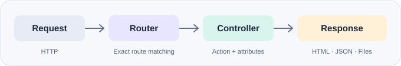

# A minimal Model-View-Control library for PHP

[](composer.json)
[](https://packagist.org/packages/richie314/simple-mvc)
[](https://github.com/Richie314/Php-Simple-MVC/releases)
[](https://github.com/Richie314/Php-Simple-MVC/actions/workflows/release.yml)

A small PHP MVC library with explicit routes, controllers, PHP views, action attributes, and utility helpers.

[Quick start](#quick-start) · [Responses](#controller-responses) · [Authentication](#authentication-and-database-integration) · [Utilities](#utilities) · [Development](#development-checks) · [Webserver setup](#webserver-configuration)



## Installation

```bash
composer require richie314/simple-mvc
```

The library requires PHP 8.2 or newer, including sensitive-parameter redaction for password arguments. The optional database integration uses `mysqli`; MIME detection uses `fileinfo`.

## Quick start

Create this directory structure:

```text
app/
  index.php
  HomeController.php
  Views/
    Home/index.php
    Shared/Layout.php
  vendor/
```

```php
<?php
// HomeController.php
use Richie314\SimpleMvc\Controllers\Controller;
use Richie314\SimpleMvc\Http\StatusCode;

class HomeController extends Controller
{
    public function index(string $name = 'World'): StatusCode
    {
        return $this->Render('Home/index', ['name' => $name], 'Welcome');
    }

    public function hello(string $first_name = 'World'): StatusCode
    {
        return $this->Json(['hello' => $first_name]);
    }
}
```

```php
<?php
// index.php
require __DIR__ . '/vendor/autoload.php';
require __DIR__ . '/HomeController.php';

use Richie314\SimpleMvc\Routers\Router;

$router = new Router(applicationInstallationPath: __DIR__);
$router->SetDefaultVariable('siteName', 'My application');
$router->AddController(HomeController::class, '/');
$router->Dispatch($_SERVER['REQUEST_URI']);
```

```php
<!-- Views/Shared/Layout.php -->
<!doctype html>
<html lang="en">
<title><?= htmlspecialchars($title, ENT_QUOTES, 'UTF-8') ?></title>
<body>
<header><?= htmlspecialchars($siteName, ENT_QUOTES, 'UTF-8') ?></header>
<?php $RenderBody(); ?>
</body>
</html>
```

```php
<!-- Views/Home/index.php -->
<h1>Hello <?= htmlspecialchars($name, ENT_QUOTES, 'UTF-8') ?>!</h1>
<a href="<?= htmlspecialchars($P, ENT_QUOTES, 'UTF-8') ?>/hello">JSON example</a>
```

Visit `/?name=Ada` for HTML or `/hello?first-name=Ada` for JSON.
GET query strings and POST form fields become named action arguments; hyphens in field names become underscores. Match action parameter names to submitted fields and provide defaults for optional values. Other request methods do not automatically bind bodies or query strings. Actions must return a `StatusCode` or a supported integer status.

`AddController()` registers public methods except names starting with `_` or `#`, plus the base route mapped to `index`. Keep helpers protected or private. To expose only specific actions, register explicit routes instead:

```php
$router->AddRouteAction('/welcome', HomeController::class, 'index');
```

For installation under `/myapp`, pass `pathPrefix: '/myapp'` to `Router` and keep route names relative to that prefix (for example `/welcome`). `$P` is available to layouts and views for generating links. Routes use exact paths; trailing slashes are significant.

## Controller responses

These calls belong inside controller actions:

```php
return $this->Content('text/plain', 'Saved');
return $this->Json(['id' => 42], StatusCode::Created);
return $this->JsonWithOptions(['url' => '/items/42'], flags: JSON_UNESCAPED_SLASHES);
return $this->RedirectWithStatus('/items/42', StatusCode::SeeOther);
return $this->File('/absolute/path/report.pdf'); // attachment by default
```

`JsonWithOptions()` and `RedirectWithStatus()` are optional helpers; existing `Json()` and `Redirect()` signatures remain unchanged. `Redirect()` retains its legacy behavior: it returns `MovedPermanently` (301), while PHP normally sends 302 for the Location header. Use `RedirectWithStatus()` when the returned and emitted status must agree.

JSON encoding failures now throw `JsonException`, which dispatch handles as a server error when headers have not been sent. Successful content and view responses explicitly set their status, including 200.

Views resolve beneath `Views/`, then `Views/Shared/`, with `.php`, `.html`, and `.htm` extensions tried for names without a dot. `Render()` accepts the existing `cutomLayout` named parameter (spelling preserved) for an alternative layout path. View data and default variables are available in both layout and body. Default variables take precedence over action data; built-in variables `$title`, `$status_code`, `$user`, `$P`, and `$RenderBody` take precedence over both. Internal rendering variables are reserved. Escape untrusted output with `htmlspecialchars()`.

Provide `Views/Shared/Error.php` to customize errors using `$main_banner` (and `$exception` for server errors). Without it, error helpers return plain text with the appropriate status. Exceptions after headers are sent are rethrown. Keep exception details out of public error templates and configure production error handling appropriately.

## Authentication and database integration

Load your application user and connection before dispatch:

```php
use Richie314\SimpleMvc\Users\User;

$user = new User();
$user->Id = 123;
$user->Name = 'Ada';
$user->Admin = false;
$router->SetUser($user);
// Optional: $router->SetDbConnection($mysqli);
```

Protect an action with the built-in attribute:

```php
use Richie314\SimpleMvc\Http\StatusCode;
use Richie314\SimpleMvc\Controllers\Attributes\RequireLogin;

#[RequireLogin(loginPath: '/login')]
public function account(): StatusCode
{
    return $this->Json(['name' => $this->User->Name]);
}
```

Use `requireAdmin: true` to additionally require `$user->Admin`. Missing users are redirected to login and the original request is stored in the `Redirect` cookie. Authentication enforcement terminates the request. Your app supplies login and user persistence.

## Utilities

```php
use Richie314\SimpleMvc\Utils\Cookie;
use Richie314\SimpleMvc\Utils\Security;

$hash = Security::Hash('a password');
$matches = Security::TestPassword('a password', $hash);

// Reads $_ENV['DB_PASSWORD'], otherwise the file in $_ENV['DB_PASSWORD_FILE'].
// File contents are returned verbatim, including empty strings and trailing newlines.
$password = Security::LoadEnvironmentOfFromFile('DB_PASSWORD', 'fallback');

Cookie::SetWithOptions('session_hint', 'value', 3600, path: '/myapp', secure: true, sameSite: 'Lax');
$value = Cookie::Get('session_hint'); // null when absent
Cookie::DeleteWithOptions('session_hint', path: '/myapp'); // match the original path and domain
```

`SetWithOptions()` and `DeleteWithOptions()` preserve existing cookie method signatures, including subclass overrides. Cookie security options are opt-in: existing calls retain `secure: false`, `httpOnly: true`, and no SameSite setting. Cookies must be written before response output. Cookie reads reflect the incoming request, not cookies just written to response headers.

`Security::GetIpAddress()` retains its existing proxy-header precedence. Enable `allowCloudlfare: true` only behind a trusted Cloudflare proxy. Forwarded headers must be sanitized by your infrastructure before using these addresses for access control.

## Development checks

From a checkout with Composer autoload files installed:

```bash
composer install
php tests/run.php
```

The dependency-free regression suite checks routing, parameter binding, rendering, response statuses, error fallbacks, cookie helpers, and environment-file loading.

The [Test and release workflow](https://github.com/Richie314/Php-Simple-MVC/actions/workflows/release.yml) runs manually from **Actions → Test and release → Run workflow**. Enter a new stable version such as `1.2.3`; it checks Composer metadata, PHP syntax, and the regression suite on **PHP 8.2–8.5** before publishing the tested commit as a tag and GitHub Release. The status badge above links to its run history.

Existing route APIs and defaults are retained except the documented bug fixes; PATCH and OPTIONS request enum cases and common response codes are additive.

## Webserver configuration

### Apache

Enable `mod_rewrite` and allow overrides for the application directory. Place this `.htaccess` beside `index.php`:

```apache
RewriteEngine On
RewriteCond %{REQUEST_FILENAME} !-f
RewriteCond %{REQUEST_FILENAME} !-d
RewriteRule ^ index.php [QSA,L]
```

Expose only the front controller and intended public assets; deny direct access to application code, views, vendor files, and configuration in your server configuration.

### Nginx

In this example the nginx server listens on port 8080 and redirectes all the traffic to `index.php`, except for the `Public` folder, where is assumed there are public static files that will be served without redirecting the request to the `index.php` file first.

In the configuration below, php is accessed via a unix socket.
 
```conf
server {
    server_name example;
    listen 8080 default_server;
    root /example;
    index index.php;

    location ~* ^/Public/ {
        try_files $uri $uri/ /index.php$is_args$args;

        # Enable compression for static assets
        gzip on;
        gzip_types text/plain text/css application/javascript application/json image/svg+xml application/xml font/woff2;
        gzip_vary on;

        # Cache static assets
        location ~* \.(?:css|js|jpg|jpeg|gif|png|ico|svg|webp|woff|woff2|ttf|eot)$ {
            expires 30d;
            add_header Cache-Control "public, immutable";
        }
    }

    location / {
        rewrite ^ /index.php last;
    }

    location ~ \.php$ {
        include fastcgi_params;
        fastcgi_pass unix:/var/run/php-app.sock;
        fastcgi_index index.php;
        fastcgi_param SCRIPT_FILENAME $document_root$fastcgi_script_name;
    }
}
```
